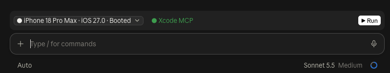

# sim-controls

[](https://ko-fi.com/cocoataster)

An iOS simulator control bar for [Claude Code](https://claude.com/claude-code). It adds one row above the prompt. Built and tested in the Claude desktop app; it is drawn through the cross-surface UI API, so it should also work in the terminal, but that is untested:



Layout, left to right:

```
[ Simulator picker ]  ● Xcode MCP                         [ ▶ Run ] [ ■ Stop ]
```

- **Simulator picker**: every available iOS simulator with its live state (`● Booted` / `○ Shutdown`). Picking one boots it.
- **Run / Reload**: builds the Xcode project found in the session folder with `xcodebuild`, installs it on the selected simulator and launches it with `simctl`. While the app is running the button becomes **Reload** (rebuild and relaunch). A spinner shows while it builds and launches.
- **Stop**: only shown while the app is running; terminates it.
- **Xcode MCP status**: green when the `xcode` MCP server is connected, yellow when it is not, dim when the check could not run.

Run and Stop are plain `xcodebuild` / `xcrun simctl` calls: no model turn and no Claude usage.

## Requirements

- macOS with Xcode and the iOS Simulator
- The `claude` CLI (the plugin uses `claude mcp get xcode` for the MCP status)
- A recent Claude Code with plugin support for UI mods (the band is drawn through the mod `ui.render` API)

## Install

```
claude plugin marketplace add cocoataster/ios-simulator-controls-claude-code-plugin
claude plugin install sim-controls@xcode-run-plugin
```

Restart Claude Code (or run `/reload-plugins`). Start your session in the folder of the Xcode project you want to run.

## How it works

- The project is the first `.xcworkspace` (else `.xcodeproj`) found up to three folders deep in the session's folder. The scheme is the one named after the project, or the first scheme.
- The simulator list and states come from `xcrun simctl list devices`.
- The Xcode MCP status comes from `claude mcp get xcode`. The plugin never calls MCP tools itself, because auto permission mode does not evaluate tool calls made by plugins.

## Limitations

- iOS simulators only (no physical devices, no other platforms).
- "Running" is tracked for the app launched from this plugin; after a restart it forgets which app it started until you press Run once.
- The status refreshes at session start, after each turn and after Run or Stop, not continuously.
- Built against the plugin UI API as of Claude Code 2.1; later versions may change it.

## Development

Tests fake `xcrun`, `xcodebuild` and `claude` through the plugin test kit, so they need neither Xcode nor a simulator:

    claude plugin test .

## Support

If this saves you clicks, you can [buy me a coffee on Ko-fi](https://ko-fi.com/cocoataster). Entirely optional.

## License

MIT, see [LICENSE](LICENSE).
